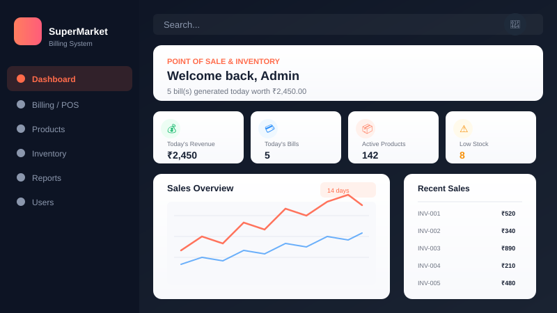
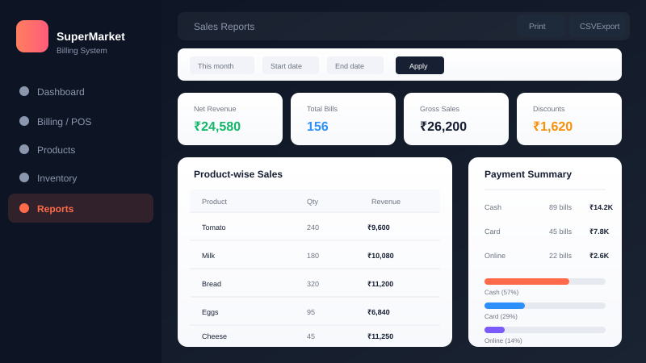

<div align="center">

# 🛒 SuperMarket Billing System

[](https://www.python.org/)
[](https://flask.palletsprojects.com/)
[](https://www.sqlite.org/)
[](https://getbootstrap.com/)
[](LICENSE)

**A modern, full-featured Point-of-Sale & Inventory Management System for Supermarkets**

[🚀 Getting Started](#-getting-started) •
[✨ Features](#-features) •
[📸 Screenshots](#-screenshots) •
[🏗️ Architecture](#%EF%B8%8F-architecture) •
[🧪 Testing](#-testing) •
[📄 License](#-license)

</div>

---

## 📸 Screenshots

<div align="center">

| 📊 Dashboard | 💳 Point of Sale |
|:---:|:---:|
|  |  |
| Sales analytics, revenue charts & recent transactions | Keyboard-first cart with barcode search & checkout |

| 📦 Inventory | 📈 Reports |
|:---:|:---:|
|  |  |
| Stock levels, low-stock alerts & adjustments | Period filters, product-wise sales & CSV export |

</div>

---

## ✨ Features

### 🔐 Authentication & Security
- **Login / Logout** with session management
- **Password hashing** via Werkzeug (PBKDF2-SHA256)
- **CSRF protection** on every form & AJAX request
- **Role-based access control** — `admin` and `cashier` roles

### 👥 Role-Based Access
| Capability | Admin | Cashier |
|:---|:---:|:---:|
| Dashboard & analytics | ✅ | ✅ |
| Point of Sale (POS) | ✅ | ✅ |
| Product management | ✅ | ❌ |
| Inventory management | ✅ | ❌ |
| Reports & exports | ✅ | ❌ |
| User management | ✅ | ❌ |
| Settings & audit log | ✅ | ❌ |
| View own sales history | ✅ | ✅ |

### 💳 Billing / POS
- 🔍 **Keyboard-first cart** with barcode / SKU / name search
- 🏷️ Product-level & bill-level percentage discounts
- 🧾 Per-product or store-wide default tax rate
- 💵 Cash tendered with automatic **change calculation**
- 🖨️ Printable receipt & **PDF invoice** (ReportLab)
- 🔄 **Idempotent checkout** via per-cart `client_token` (prevents double-charge)

### 📦 Inventory Management
- Real-time stock level tracking
- Low-stock & out-of-stock filters
- Manual stock adjustments with **audit trail**
- Complete **stock movement history**

### 📈 Reports & Analytics
- Period filters: **Today / Week / Month / Year / Custom**
- Product-wise sales breakdown
- Payment method summary (Cash / Card / Online)
- Printable report & **CSV export**
- Dashboard with **Chart.js** revenue & bill trends

### 🛡️ Audit Logging
Every action is recorded — logins, product changes, stock adjustments, sales, and settings modifications.

---

## 🏗️ Technology Stack

| Layer | Technology |
|:---|:---|
| **Backend** | Flask 3, Flask-SQLAlchemy, Flask-Login, Flask-WTF |
| **Database** | SQLite (default) — any SQLAlchemy-supported DB via `DATABASE_URL` |
| **Frontend** | Jinja2 templates, Bootstrap 5, Bootstrap Icons, Chart.js |
| **PDF** | ReportLab (optional) |
| **Styling** | Custom CSS with coral/grey branding, Quicksand & Inter fonts |
| **Testing** | pytest with in-memory SQLite |

---

## 🚀 Getting Started

### Prerequisites
- **Python 3.10+** installed
- **pip** package manager

### Installation

```bash
# 1. Clone the repository
git clone https://github.com/yourusername/supermarket-billing-system.git
cd supermarket-billing-system

# 2. Create a virtual environment
python -m venv .venv

# 3. Activate it
# Windows:
.venv\Scripts\activate
# macOS/Linux:
source .venv/bin/activate

# 4. Install dependencies
pip install -r requirements.txt
```

### Configuration

```bash
# Copy the example environment file
cp .env.example .env

# Edit .env to set your preferences:
#   SECRET_KEY, STORE_NAME, DATABASE_URL, etc.
```

### Initialize the Database

```bash
# Creates tables, default category & admin user
python manage.py init

# The admin password is either ADMIN_PASSWORD from .env
# or a randomly generated one printed on first init.

# Create additional admin users:
python manage.py create-admin --username owner --password "ChangeMe!123"
```

### Run the Application

```bash
python app.py
# → Open http://127.0.0.1:5000 in your browser
```

### Optional: Seed Demo Data

```bash
python manage.py seed-demo
```

### Optional: Migrate from Legacy MongoDB

```bash
pip install pymongo
python manage.py migrate-mongo --mongo-url mongodb://127.0.0.1:27017/supermarket
```

---

## 🧪 Testing

```bash
pip install pytest
pytest -q
```

Tests use an in-memory SQLite database and cover:
- Authentication & authorization
- Product CRUD operations
- Billing calculations & discounts
- Stock deduction & adjustments
- Idempotent checkout
- Inventory audit trail

---

## 📁 Project Structure

```
supermarket-billing-system/
├── app.py                  # Application factory + entry point
├── manage.py               # CLI: DB init, admin provisioning, migration
├── config.py               # Environment-based configuration
├── extensions.py           # Flask extensions (db, CSRF, login manager)
├── models.py               # SQLAlchemy models
├── utils.py                # Input parsing/validation helpers
├── requirements.txt        # Python dependencies
├── .env.example            # Environment variable template
├── services/
│   ├── billing_service.py  # Authoritative checkout/pricing logic
│   ├── inventory_service.py# Stock adjustments (atomic)
│   ├── invoice_service.py  # Invoice numbering + PDF rendering
│   ├── report_service.py   # Report/analytics queries
│   ├── settings_service.py # Settings & audit helpers
│   └── audit_service.py    # Audit logging
├── routes/
│   ├── auth.py             # Login/logout/change password
│   ├── dashboard.py        # Dashboard & analytics
│   ├── billing.py          # POS, checkout, invoices
│   ├── products.py         # Product CRUD
│   ├── inventory.py        # Stock management
│   ├── reports.py          # Reports & exports
│   ├── users.py            # User management
│   └── settings.py         # Store settings
├── templates/              # Jinja2 templates
│   ├── base.html           # Base layout with sidebar
│   ├── dashboard.html      # Dashboard with charts
│   ├── billing.html        # POS interface
│   ├── products.html       # Product listing
│   ├── inventory.html      # Inventory management
│   ├── reports.html        # Reports page
│   ├── invoice.html        # Invoice/receipt view
│   ├── users.html          # User management
│   ├── settings.html       # Store settings
│   ├── audit.html          # Audit log viewer
│   └── errors/             # Error pages (403, 404, 500)
├── static/
│   ├── css/style.css       # Custom styles (coral/grey branding)
│   ├── js/billing.js       # POS cart logic
│   ├── js/app.js           # General app JS
│   └── images/             # Static images
├── screenshots/            # README screenshots
├── tests/                  # pytest suite
│   ├── conftest.py         # Test fixtures
│   ├── test_auth.py
│   ├── test_authorization.py
│   ├── test_products.py
│   ├── test_billing.py
│   └── test_inventory.py
└── legacy/                 # Original MERN implementation (reference)
```

---

## ⚙️ Environment Variables

See `.env.example` for the full list. Key variables:

| Variable | Default | Purpose |
|:---|:---|:---|
| `SECRET_KEY` | dev value | Session signing secret |
| `DATABASE_URL` | `sqlite:///instance/supermarket.db` | SQLAlchemy database URI |
| `FLASK_ENV` | `development` | `development` / `production` / `testing` |
| `HOST` / `PORT` | `127.0.0.1:5000` | Bind address |
| `STORE_NAME` | — | Store name on receipts |
| `STORE_ADDRESS` | — | Store address on receipts |
| `STORE_PHONE` | — | Store phone on receipts |
| `STORE_EMAIL` | — | Store email on receipts |
| `STORE_GSTIN` | — | GST number on receipts |
| `CURRENCY_SYMBOL` | `₹` | Currency symbol |
| `DEFAULT_TAX_RATE` | `0` | Store-wide tax % |
| `DEFAULT_LOW_STOCK_THRESHOLD` | `10` | Low-stock alert level |
| `ADMIN_USERNAME` | `admin` | Bootstrap admin username |
| `ADMIN_PASSWORD` | generated | Bootstrap admin password |

---

## 📄 License

This project is licensed under the **MIT License** — see the [LICENSE](LICENSE) file for details.

---

<div align="center">

**⭐ Star this repo if you find it useful!**

Made with ❤️ using **Flask** & **Bootstrap 5**

</div>
